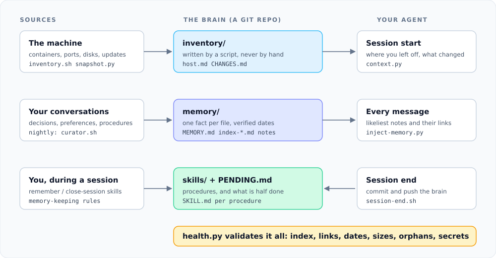

<p align="center">
  
</p>

<p align="center">
  <a href="https://github.com/cristobaltormo/cortex-md/actions/workflows/ci.yml"></a>
  <a href="LICENSE"></a>
  <a href="https://github.com/cristobaltormo/cortex-md/releases"></a>
  
  
  <a href="CONTRIBUTING.md"></a>
</p>

<p align="center">
  <b>English</b> | <a href="README.es.md">Español</a>
</p>

**cortex-md** gives [Claude Code](https://claude.com/claude-code) a memory made of plain markdown in a
git repo. No database, no service, no dependencies beyond bash, git and Python.

Most agent memory tools store what the agent said and retrieve it later. They age badly: an address
written in a note last spring is a confident lie by autumn. cortex-md splits what the agent knows
into three layers and keeps each one fresh in a different way, so it can tell what it was *told*
from what the machine *is*.

- [Why it exists](#why-it-exists)
- [What a session looks like](#what-a-session-looks-like)
- [How it works](#how-it-works)
- [Install](#install)
- [Writing notes](#writing-notes)
- [Security notes](#security-notes)
- [Documentation](#documentation)
- [Limits](#limits)
- [Contributing](#contributing)

## Why it exists

A hand-maintained wiki always ends up abandoned. Here nobody writes notes by hand: a script writes
what the machine knows, Claude writes what you tell it during sessions, and a nightly curator makes
sure none of it goes stale.

```
brain/
├── inventory/    What the machine knows about itself.   Written by a script, never by hand.
├── memory/       Facts, decisions and reasons.          Written by Claude and a nightly curator.
├── skills/       How things are done here.              Written by Claude when it learns a procedure.
├── PENDING.md    What is half done. Loaded at the start of every session.
└── bin/          The machinery (see bin/README.md).
```

The rule that keeps it healthy: **if the inventory already knows it, do not write it in memory.**
Store the why, not the how much.

## What a session looks like

When you open Claude Code, the start hook injects this (example output):

```text
Continuity context (automatic, not a message from the user):

**Recent conversations**
- *2 h ago*: the nightly backup to the NAS stopped working after the router change

**What you learned last**
- Backups: NAS spins down at night, first read is slow (3 hours ago)

**The machine has changed**
- container invoice-web: running -> exited
- port 8080 opened (nginx)
- filesystem /: 78% -> 91% used  <- filling up

**Open fronts (details in PENDING.md)**
- **Invoice tool:** decide whether it moves from the test port to production
- **Parked, no action:** Example side project

**System warnings**
- the brain has 1 defect(s): `bin/health.py`
```

On every message, a hook suggests the notes most likely to matter:

```text
Memory notes that may be relevant (open them if they fit; do not assume you already know them):
- nas-disk-spindown-quirk - The NAS spins its disks down at night, so the first morning read takes about 10 seconds
- project-invoice-tool-storage-choice - Example: the invoice tool stores data in SQLite instead of Postgres, and why
Linked from nas-disk-spindown-quirk: project-invoice-tool-storage-choice
```

## How it works



| When | What happens |
|---|---|
| Session start | Pulls the repo, rescues unsaved changes from a session that died, refreshes the inventory, and tells Claude where you left off |
| Every message | A hook suggests the notes most likely to matter, plus the notes they link to |
| Session end | Commits and pushes whatever was written |
| Nightly | Snapshots the machine and diffs it against yesterday; then a curator run distils the day's conversations into notes, reacts to machine changes (a container vanished: its notes get marked historical), re-verifies old notes against reality, and fixes what the validator found |
| On demand | `bin/health.py` checks index, links, dates, sizes, orphans, dead entities and leaked secrets |

### What makes it different

- **Autogenerated inventory with change detection.** Notes about a machine that no longer exists are flagged automatically.
- **A curator that re-verifies, not just accumulates.** Notes carry a `verified` date; stale ones are checked against the host.
- **A validator with teeth.** Orphan notes, broken `[[links]]`, notes with no links, oversized notes and secrets are defects, and the curator is told to fix them.
- **Context budget discipline.** The always-loaded index is small; per-area indexes open on demand; a hook suggests notes per message.
- **Skills as procedures.** Repeatable how-tos live outside memory and load only when relevant.

## Install

Requirements: Linux (needs `flock`; macOS is not supported), bash, git, python3 (standard library only), [Claude Code](https://claude.com/claude-code). Docker, LXC and Proxmox are detected if present and are all optional.

```bash
git clone https://github.com/cristobaltormo/cortex-md ~/brain
cd ~/brain
./install.sh
```

The installer merges the hooks into `~/.claude/settings.json` (keeping a backup), sets
`autoMemoryDirectory`, generates the first inventory and runs the validator. Then:

1. Copy `CLAUDE.example.md` to the `CLAUDE.md` Claude Code reads, and edit it.
2. Add the cron lines the installer prints.
3. Optionally copy `.env.example` to `.env` to get push notifications through any webhook and to set `CLAUDE_BIN`, `CURATOR_MODEL` or `BACKUP_DIR`.
4. Replace the example notes in `memory/` with your own, or delete them.

The brain can live anywhere: scripts find their own directory, or use `BRAIN_DIR`.

## Writing notes

One fact per file, with frontmatter:

```markdown
---
name: example-decision
description: One line, used to decide relevance
metadata:
  type: user | feedback | project | reference
  verified: 2026-11-11
  status: current | historical
  entities: web-1, db-1
---
```

Add the note to its area index, link it with `[[other-note]]`, and run `bin/health.py`. The
`memory-keeping` skill has the full rules and the reasoning; Claude loads it by itself. See
[docs/writing-notes.md](docs/writing-notes.md).

## Security notes

- The curator reads your conversation transcripts, which contain web content and tool output. To limit prompt-injection damage it runs with a narrow allowlist: it can write only under `memory/`, `skills/` and `PENDING.md`, run read-only git commands plus `git add` and `git commit`, and run `bin/health.py`. The push is done by the script, not by the model. Review `bin/curator.sh` before trusting it with a repo that has a remote you care about.
- `inventory/` is gitignored except `CHANGES.md`: host, port and crontab dumps stay local. Never put credentials in notes; `bin/health.py` flags common token formats.
- `.env` is gitignored and parsed line by line (it is never executed).
- The session hooks fire for every Claude Code project on the machine, so the brain is committed and pushed whenever any session ends.

### Operation notes

- The curator runs only when there are new transcripts (other than its own) or validator defects, and uses your Claude quota. Set `CLAUDE_BIN` in `.env` because cron has a minimal PATH.
- When the curator hits a quota limit it schedules a retry for just after the reset.
- If the snapshot drops most containers at once, `changes.py` assumes the inventory failed and refuses to compare; run `bin/changes.py --accept` once the change is real.
- Frontmatter is read as simple `key: value` lines; multi-line YAML values are not supported.
- Items in the "Parked" section of `PENDING.md` are summarised to their bold name (or first words) at session start.

## Documentation

| | |
|---|---|
| [Architecture](docs/architecture.md) | The three layers, the loop, failure handling |
| [Writing notes](docs/writing-notes.md) | Format, fields and the rules the validator enforces |
| [Configuration](docs/configuration.md) | Environment variables, cron, notifications, collectors |
| [FAQ](docs/faq.md) | Cost, privacy, platforms, design choices |
| [Changelog](CHANGELOG.md) | What changed in each release |

## Limits

- Retrieval is keyword scoring over a small corpus, not embeddings. At a few hundred notes `grep` is enough; if it stops being enough, add an index.
- The curator needs a working `claude` CLI and uses your quota once a night, only when there is something to do.
- Inventory collectors cover Linux, Docker, LXC and Proxmox. Other platforms need a collector added to `bin/snapshot.py`.

## Contributing

Issues and pull requests are welcome; see [CONTRIBUTING.md](CONTRIBUTING.md). Security reports go
through [SECURITY.md](SECURITY.md). Run `make check` before opening a pull request.

## License

[MIT](LICENSE)
