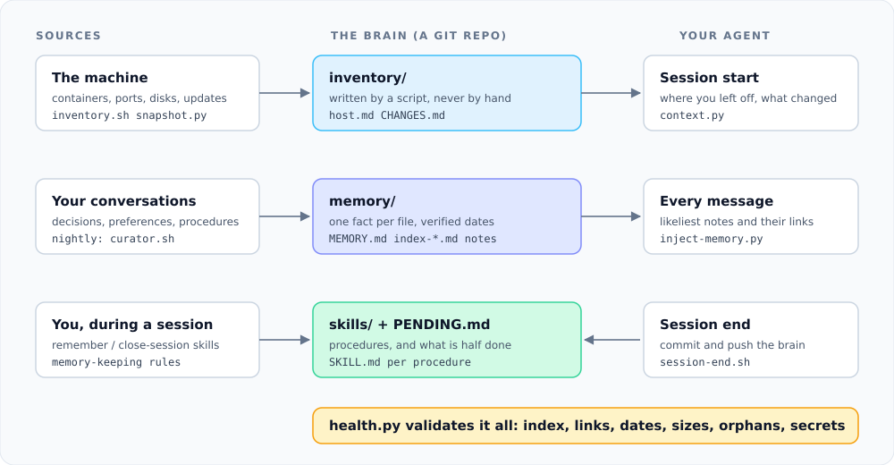

# Architecture

## Why three layers

An agent's knowledge about a machine has three different lifetimes, and mixing them is what makes
most memory systems rot.

| Layer | Truth comes from | Fresh because |
|---|---|---|
| `inventory/` | The machine itself | A script regenerates it; nobody edits it |
| `memory/` | Conversations with the user | A curator re-verifies it against reality |
| `skills/` | Procedures that worked | They are loaded only when relevant, and corrected when they fail |

The rule that ties them together: if the inventory already knows a fact, it must not be written in
memory. An address typed into a note is a future lie. Memory stores the reason, the inventory stores
the value.

## The loop

1. **Session start.** `session-start.sh` pulls the repo, commits changes left by a session that died,
   refreshes a stale inventory in the background and runs `context.py`, which prints recent
   conversations, the latest commits (what was learned), machine changes of the last two days, the
   open fronts from `PENDING.md` and any system warnings.
2. **Every message.** `inject-memory.py` scores the prompt against the notes (header words weigh five
   times more than body words, words that appear in more than 30 percent of notes are ignored) and
   suggests up to three, plus the notes linked from the best one.
3. **Session end.** `session-end.sh` commits what was written and pushes.
4. **Nightly.** `inventory.sh` regenerates `inventory/`, `snapshot.py` stores `state.json`, and
   `changes.py` diffs it against yesterday. Then `curator.sh` runs a headless Claude Code session with a narrow
   allowlist to distil the day, react to the changes, re-verify old notes and fix validator defects.
5. **Always.** `health.py` is the guard: the curator is told to fix whatever it reports, and the
   session start warns when it reports anything.

## Dead-entity detection

A note may list `entities: web-1, db-1` in its frontmatter. When `snapshot.py` no longer finds a
container or machine with that name, `health.py` flags the note, and the curator marks it
`status: historical` instead of deleting it. Knowing that something existed and was removed is
information.

## Failure handling

- The curator holds a lock, trims its own log and skips the night when there is nothing new.
- On a quota limit it schedules a retry for just after the reset (`state/retry-at`), checked every
  15 minutes by `curator-retry-check.sh`. Two failed nights in a row send a notification.
- `changes.py` refuses to compare when most containers vanish at once, since that usually means the
  inventory failed, not that everything was deleted. `--accept` overrides it.

## What it deliberately does not do

No embeddings, no vector store, no daemon. Retrieval is keyword scoring over a corpus small enough
for `grep`, because notes are curated and kept few. If the corpus outgrows that, add an index note.
